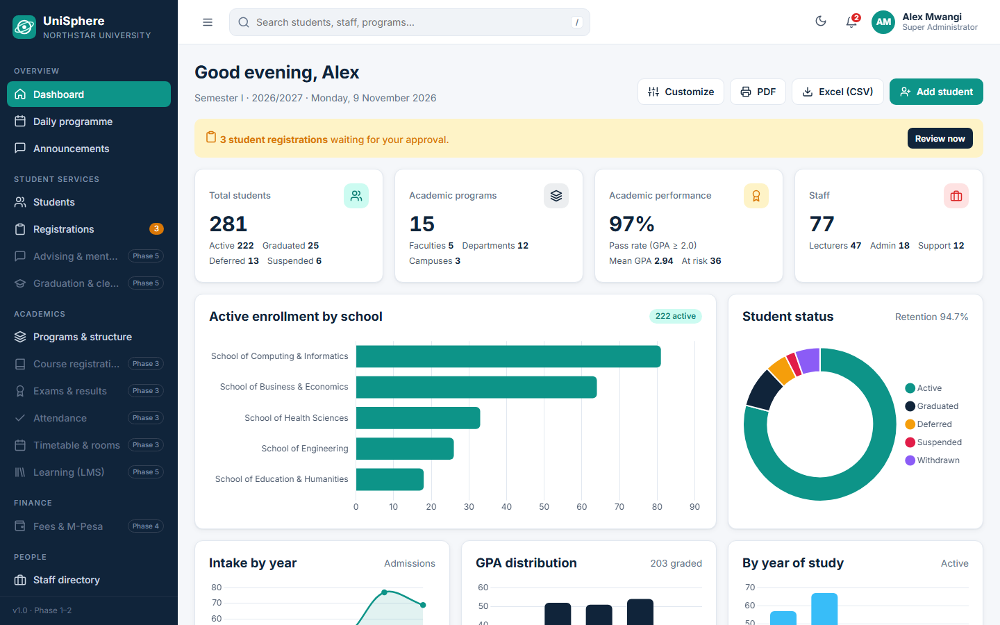
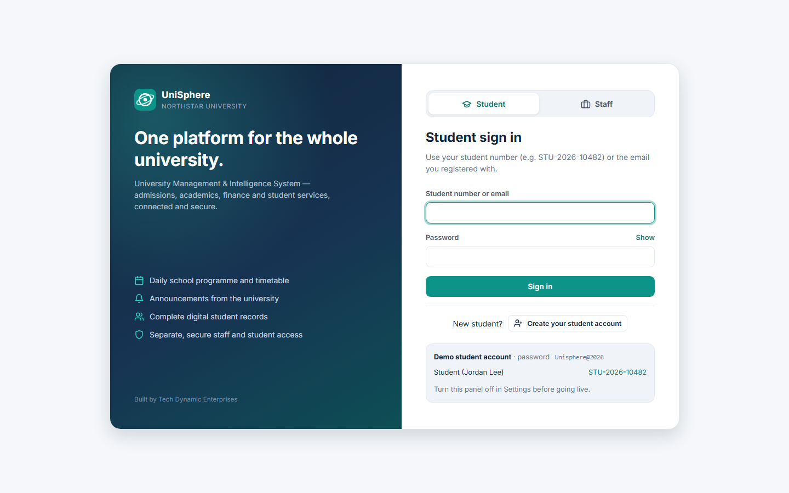
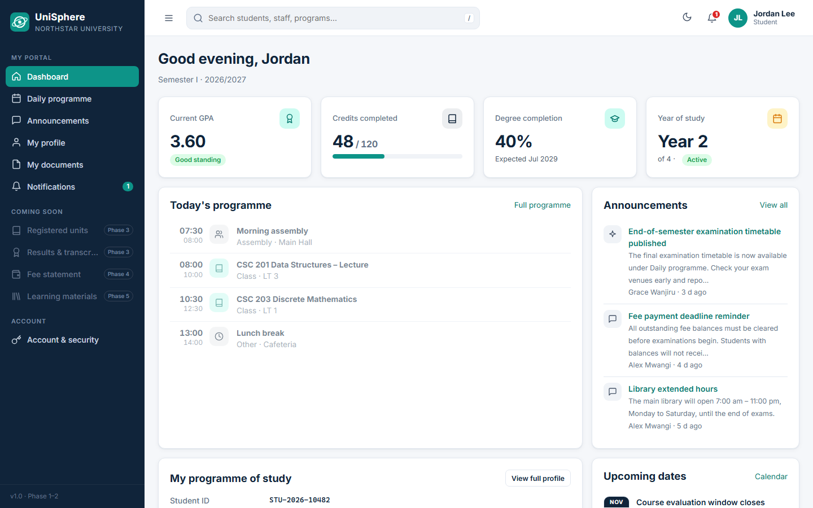
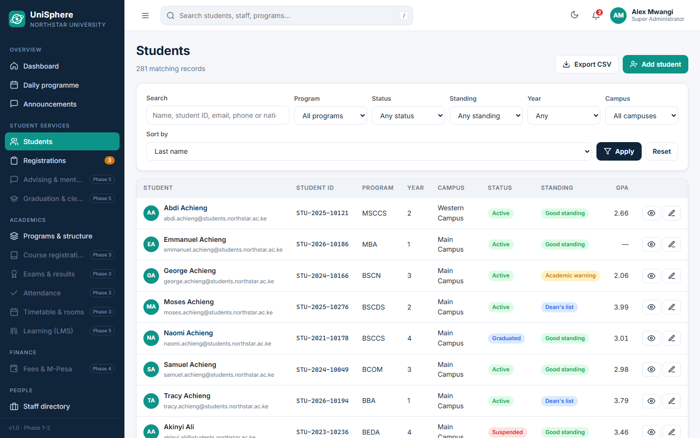

# UniSphere – Student Information Management System

A multi-role university **student information management system** built with PHP 8 and MySQL/MariaDB. It runs on XAMPP with no Composer, Node or build step. Built by **Tech Dynamic Enterprises**.

UniSphere gives administrators, registrars, finance officers, lecturers and students their own portals over one shared database of student records, programmes, schedules and announcements.



> **Status:** Phase 1 (Foundation) and Phase 2 (Student records) are complete and working. Later modules appear in the sidebar as locked roadmap items (see [Roadmap](#roadmap)).

## Contents

- [Features](#features)
- [Screenshots](#screenshots)
- [Requirements](#requirements)
- [Installation](#installation)
- [Demo accounts](#demo-accounts)
- [Sign-in portals and student registration](#sign-in-portals-and-student-registration)
- [Daily programme and announcements](#daily-programme-and-announcements)
- [Upgrading an existing installation](#upgrading-an-existing-installation)
- [Configuration](#configuration)
- [Security](#security)
- [Backups](#backups)
- [Project structure](#project-structure)
- [Roadmap](#roadmap)

## Features

**Phase 1 – Foundation**
- Sign-in with Argon2id password hashing (bcrypt fallback), login throttling (5 failures per account or 20 per IP in 15 minutes), session ID regeneration and an idle timeout.
- Role-based access control: 5 roles and 13 permissions, editable in a matrix (**Roles & permissions**). Super Administrators always hold every permission.
- User management: create and edit users, assign roles, suspend or reactivate, and reset passwords. Resets issue a one-time temporary password that must be changed at next sign-in.
- Separate dashboards:
  - Analytics dashboard for admin, registrar and finance: KPIs, 5 charts, activity feed, calendar, quick actions, show/hide widgets, PDF export via print, CSV export for Excel.
  - Lecturer dashboard.
  - Student portal.
- Audit trail covering record changes (with before/after values), record views, document downloads, exports, denied access attempts and sign-in history.
- Settings: institution profile, academic terms, academic calendar, and a security checklist.
- Global search (press `/`), notifications with polling, and dark/light mode.
- Responsive layout with a collapsible sidebar.

**Phase 2 – Student records**
- Student list: search, filters (programme, status, standing, year, campus), sorting, pagination and CSV export.
- Add/edit students:
  - Validation and automatic student numbers (`STU-YYYY-NNNNN`).
  - Photo upload and guardian details.
  - Optional student portal login.
- Student profile with Overview, Guardians, Documents, Academic record and History tabs, plus enrollment status changes that require a reason.
- Secure document storage: file types are checked by their actual content, files get random names under `storage/`, Apache blocks direct access, and downloads only go through `document.php` after a permission check.
- Student self-registration with an admin approval workflow.
- Daily programme (timetable) and announcements.
- Faculties, departments, programmes and campuses (multi-campus ready).
- Staff directory.

## Screenshots

| Sign in | Student portal |
|---|---|
|  |  |

| Student records |
|---|
|  |

All names and records in the screenshots are fictional demo data.

## Requirements

- PHP 8.0 or newer with the `pdo_mysql`, `mbstring` and `fileinfo` extensions (all enabled by default in XAMPP)
- MySQL 5.7+ or MariaDB 10.3+
- Apache with `.htaccess` support (`AllowOverride All`)

[XAMPP](https://www.apachefriends.org/) provides all of these in one install.

## Installation

1. **Get the code** into your XAMPP `htdocs` folder (the folder name `ims` is used below, but any name works):

   ```bash
   cd C:\xampp\htdocs
   git clone https://github.com/Robatech348/student-information-management-system.git ims
   ```

   Alternatively, download the ZIP from GitHub and extract it to `C:\xampp\htdocs\ims`.

2. **Start Apache and MySQL** in the XAMPP Control Panel.

3. **Create the database and demo data** using **one** of these options:
   - In a browser, open http://localhost/ims/install.php and click **Install now**.
   - Or from the command line:

     ```bash
     C:\xampp\php\php.exe C:\xampp\htdocs\ims\install.php
     ```

   The installer creates the `unisphere` database, its tables and the demo data, then locks itself (`storage/installed.lock`) so it cannot be run again from the web.

4. **Sign in** at http://localhost/ims/ with one of the demo accounts below.

To rebuild the database from scratch, run `php install.php --fresh`. **This erases all data.**

If your MySQL `root` user has a password, or you use another database name, set it in `config/config.local.php` before installing (see [Configuration](#configuration)).

## Demo accounts

Every demo account uses the password `Unisphere@2026`.

| Portal | Sign in with | Role |
|---|---|---|
| Staff | admin@northstar.ac.ke | Super Administrator |
| Staff | registrar@northstar.ac.ke | Registrar / Academic Officer |
| Staff | finance@northstar.ac.ke | Finance Officer |
| Staff | lecturer@northstar.ac.ke | Lecturer |
| Student | student@northstar.ac.ke or `STU-2026-10482` | Student (Jordan Lee) |

Change these passwords and turn off the demo-credentials panel in **Settings** before real use.

## Sign-in portals and student registration

The sign-in page has two tabs:

- **Staff:** admin, registrar, finance and lecturers sign in with their staff email. Staff accounts are created only by an administrator under **Users & access**; there is no staff self-registration.
- **Student:** students sign in with their student number (e.g. `STU-2026-10482`) or email. Each account only works on its own tab.

New students click **Create your student account** and give their name, email, phone, gender, date of birth, ID number, programme, campus and a password. Admin controls what happens next under **Settings → Student self-registration**:

| Mode | Result |
|---|---|
| Requires approval (default) | The student gets an `APP-…` reference and cannot sign in until the admin or registrar approves them under **Registrations**. Approval assigns the official `STU-…` number (the programme and year can be corrected first) and notifies the student. Rejection requires a reason, which the applicant sees when they try to sign in. |
| Instant access | The student number is issued immediately and the student is signed in. |
| Closed | Only staff can add students. |

The registration form blocks bots with a hidden field and allows at most 5 registrations per IP address per hour.

## Daily programme and announcements

- **Daily programme** (`programme.php`):
  - Admin and registrar add classes, CATs and exams, assemblies, sports, meetings and events, with time and venue.
  - Each item can be aimed at everyone, a school, a programme (optionally a single year) or a whole year of study.
  - Items can repeat every weekday or weekly until a chosen date, and can be deleted one at a time or as a whole series.
  - Students see only what applies to them. "Happening now" is highlighted and the student dashboard shows today's schedule.
- **Announcements** (`announcements.php`):
  - Can be posted to everyone, students only or staff only.
  - Can be pinned, set to expire, and optionally sent as a notification to everyone in the audience.

Three permissions control these features: `registrations.approve`, `schedule.manage` and `announcements.manage`. They are granted to Super Administrator and Registrar, and can be changed in **Roles & permissions**.

## Upgrading an existing installation

After pulling new code, apply new database migrations from `database/migrations/` without losing data:

```bash
php migrate.php
```

Add `--demo` to also load the sample daily programme, announcements and pending registrations.

## Configuration

Default settings live in [`config/config.php`](config/config.php). **Do not edit that file for your own server.** Instead, create `config/config.local.php` and return only the values you want to change. It is merged over the defaults and is excluded from Git by `.gitignore`, so passwords never get committed.

```php
<?php
return [
    'debug' => false,
    'db' => [
        'host' => '127.0.0.1',
        'name' => 'unisphere',
        'user' => 'unisphere_app',
        'pass' => 'a-strong-password',
    ],
];
```

Other settings include the timezone (default `Africa/Nairobi`), session idle timeout, login throttling limits, minimum password length, and upload size and file-type limits.

## Security

- Every query uses PDO prepared statements, and all output is HTML-escaped.
- Every form carries a CSRF token, and every action that changes data requires POST.
- A Content-Security-Policy is set, with no inline scripts. Chart.js is served locally from `assets/vendor/`.
- `.htaccess` files deny web access to `config/`, `includes/`, `database/` and `storage/`.
- CSV exports are protected against spreadsheet formula injection.

**Before production:**
- Use a dedicated MySQL user with a strong password, set in `config/config.local.php`.
- Set `'debug' => false`.
- Enable HTTPS.
- Turn off demo credentials in **Settings**.
- Change all demo passwords.

Personal data handling should follow Kenya's Data Protection Act, 2019 (or the data protection law that applies where you deploy).

## Backups

Run this nightly with Windows Task Scheduler (adjust the paths to your installation):

```bat
C:\xampp\mysql\bin\mysqldump.exe -u root --single-transaction unisphere > D:\backups\unisphere-%date:~-4%%date:~3,2%%date:~0,2%.sql
robocopy C:\xampp\htdocs\ims\storage D:\backups\storage /MIR
```

## Project structure

```
├── assets/            CSS, JavaScript, images and vendor libraries (Chart.js)
├── config/            Default configuration (override in config.local.php)
├── database/
│   ├── schema.sql     Database tables
│   ├── seed.php       Demo data
│   └── migrations/    Incremental schema changes
├── docs/screenshots/  Images used in this README
├── includes/          Bootstrap, database, auth/RBAC/CSRF, helpers, layout, icons
├── storage/           Uploaded photos and documents (not web-accessible, not in Git)
├── install.php        One-time installer
├── migrate.php        Applies new migrations
├── login.php          Staff and student sign-in
├── register.php       Student self-registration
├── dashboard.php      Role-specific dashboards
├── students.php       Student list
├── student_form.php   Add / edit student
├── student_view.php   Student profile
└── …                  Other pages (users, roles, settings, audit, programme, announcements)
```

## Roadmap

| Phase | Scope |
|---|---|
| 1 – Foundation ✅ | Authentication, RBAC, users, dashboards, audit trail, settings |
| 2 – Student records ✅ | Student records, documents, self-registration, programme, announcements |
| 3 – Academics | Courses and offerings, unit registration (prerequisites, capacity, credit limits, add/drop), exams and marks, automated GPA/CGPA, transcripts, attendance (QR), timetable |
| 4 – Finance | Fee structures, invoices, M-Pesa Daraja STK push and reconciliation, receipts, scholarships, holds |
| 5 – Portals & communications | Full lecturer/registrar/finance portals, LMS, email/SMS, support tickets, advising |
| 6 – Intelligence | At-risk prediction, AI assistant, automated reports (advisory only; humans decide) |
| 7 – Deployment | Tests, security audit, Docker, CI/CD, hosting |

## Author

Developed by **Robinson Amianda** ([@Robatech348](https://github.com/Robatech348)) for Tech Dynamic Enterprises.
